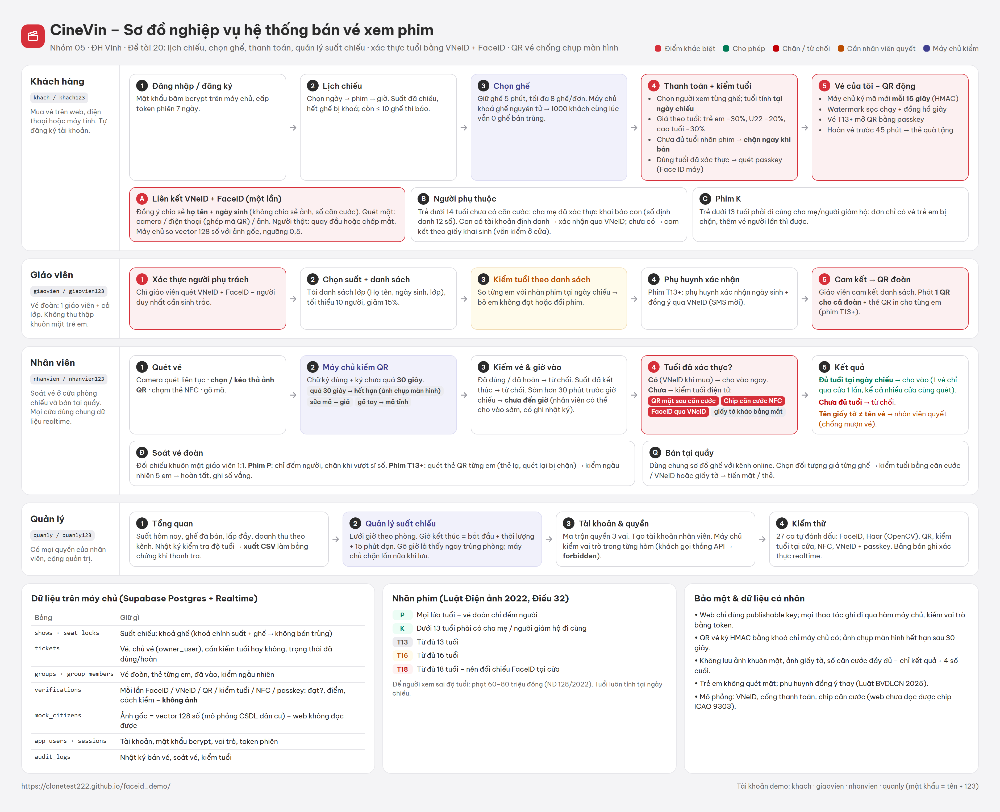

# CineVin – bán vé xem phim, xác thực tuổi bằng VNeID + FaceID

Demo đồ án PTTKHTTT – Nhóm 05, ĐH Vinh. Đề tài 20: lịch chiếu, chọn ghế, thanh toán, quản lý suất chiếu.

**Bài toán:** rạp bị phạt 60–80 triệu đồng nếu để người xem sai độ tuổi, nhưng hiện chỉ kiểm tra giấy tờ bằng mắt ở cửa; trẻ em thường chưa có căn cước; đoàn 1 giáo viên – 50 học sinh thì không thể kiểm tra từng em; vé điện tử chụp màn hình là gửi cho người khác dùng được.

**Giải pháp:**
- Xác thực **một lần** bằng VNeID + khuôn mặt → hệ thống biết ngày sinh thật, tự áp giá theo tuổi và **chặn ngay khi bán** vé T13/T16/T18.
- Trẻ chưa có căn cước → **hồ sơ người phụ thuộc** của cha mẹ đã xác thực.
- Vé đoàn → chỉ xác thực sinh trắc **giáo viên**, kiểm tra tuổi **theo danh sách**, một QR cho cả đoàn; phim P chỉ đếm người, phim từ T13 quét thẻ QR từng em + kiểm tra ngẫu nhiên.
- **QR vé đổi mỗi 15 giây**, máy chủ ký HMAC; máy soát chỉ nhận mã chưa quá 30 giây → ảnh chụp màn hình bị từ chối.

## Sơ đồ nghiệp vụ

Bản HTML để sửa: `docs/nghiep-vu.html` → xuất lại ảnh bằng `node tools/render-png.mjs docs/nghiep-vu.html docs/nghiep-vu.png`.

## Đăng nhập & phân quyền
| Tài khoản demo | Mật khẩu | Vai trò | Vào được |
|---|---|---|---|
| `khach` | `khach123` | Khách hàng | Lịch chiếu, chọn ghế, thanh toán, vé của tôi, vé đoàn, tài khoản |
| `giaovien` | `giaovien123` | Khách hàng | như trên (dùng để thử vé đoàn) |
| `nhanvien` | `nhanvien123` | Nhân viên · rạp 086 Vinh Centre | Soát vé, bán tại quầy (chỉ suất của rạp mình) |
| `quanlyvinh` | `quanlyvinh123` | Quản lý rạp · 086 Vinh Centre | Tổng quan, suất chiếu, quầy, soát vé, tạo nhân viên **cho rạp mình** |
| `quanly` | `quanly123` | Quản lý chuỗi | Mọi rạp: bảng toàn chuỗi theo tỉnh → rạp, đổi rạp đang thao tác, tạo tài khoản cho rạp bất kỳ |

Mật khẩu băm bcrypt trên máy chủ; mỗi hàm nhạy cảm nhận token phiên và **tự kiểm vai trò ở máy chủ** (khách gọi thẳng API thêm suất → `forbidden`). Khách tự đăng ký được; tài khoản nhân viên do quản lý tạo.

## Chuỗi nhiều rạp (migration 006)
Mô hình **Tỉnh/Thành → Rạp (mã 3 số) → Phòng → Suất**, 7 rạp ở 4 tỉnh/thành; Nghệ An có **2 cơ sở cùng TP Vinh** (086 Vinh Centre, 087 Hưng Dũng) để thử tình huống "một nơi nhiều cơ sở".

| Việc | Cách làm |
|---|---|
| Khách chọn rạp | Nút rạp trên đầu trang: Tỉnh/Thành → rạp (địa chỉ, số phòng, giá từ). Nhớ trên thiết bị. Lịch xem **theo rạp** (ngày → phim → suất theo định dạng 2D/3D/GOLD) hoặc **theo phim** (phim → ngày → tỉnh → từng rạp → suất) |
| Giá vé theo rạp | Hạng A (Hà Nội, TP.HCM) / hạng B (tỉnh); ngày thường · thứ Tư · cuối tuần × người lớn / U22 / trẻ em / người cao tuổi; phụ thu ghế VIP, 3D, phòng GOLD. Giá tính ở `seatPrice(suất, ghế, đối tượng)`; đối tượng lấy từ tuổi **đã xác thực VNeID** nên bán được vé U22/trẻ em/cao tuổi online |
| Mã suất, mã phòng | `YYYYMMDD-<rạp>-n`, phòng `<rạp>-R1` → mọi suất, vé, QR đều mang mã rạp; máy chủ chưa chạy 006 vẫn suy ra rạp từ mã phòng |
| Nhân viên gắn rạp | `app_users.cinema_id`; soát vé / quầy / thêm suất ở rạp khác → máy chủ trả `wrong_cinema`; màn soát vé báo "Vé của rạp khác" kèm tên rạp đúng |
| Quản lý chuỗi | `cinema_id = null`: tổng quan toàn chuỗi (suất, ghế bán, lấp đầy, doanh thu theo tỉnh → rạp), ô đổi rạp đang thao tác trên thanh tiêu đề; `chain_stats(ngày)` tính ở máy chủ |

## Nghiệp vụ khách hàng (migration 005)
| Bước | Cách làm |
|---|---|
| Đăng ký | Họ tên, email, SĐT, tên đăng nhập, mật khẩu (kiểm định dạng và trùng ở máy chủ). Tạo xong được mời **xác thực VNeID + FaceID** ngay, có thể để sau |
| Đăng nhập | **Mật khẩu** (tên đăng nhập / email / SĐT) · **FaceID** (camera hoặc ảnh → máy chủ so vector với ảnh gốc của hồ sơ VNeID đã liên kết; thất bại cũng ghi bản ghi) · **VNeID** (mô phỏng app VNeID trả hồ sơ đã đồng ý chia sẻ) |
| Hồ sơ | Liên kết VNeID **lưu trên máy chủ** (đổi thiết bị vẫn còn; một hồ sơ chỉ gắn một tài khoản); điểm thưởng; lịch sử đặt vé; voucher; tuỳ chọn "xác nhận mỗi lần đặt vé bằng passkey" |
| Người đi cùng | Ở bước thanh toán chọn "Bạn đi cùng có tài khoản" → nhập email/SĐT/tên đăng nhập → máy chủ trả tên, đã xác thực VNeID chưa, tuổi tại ngày chiếu (không lộ ngày sinh). Bạn đã xác thực → vé `verified`, **ở cửa không cần giấy tờ**, chưa đủ tuổi thì chặn ngay; vé hiện trong "Vé của tôi" của bạn đó kèm QR riêng |
| Đặt vé | Mã khuyến mãi (`CHAONHOM05` −10%) / thẻ quà tặng + điểm thưởng (1 điểm = 1.000 đ) tính ở máy chủ; cộng 5% điểm; phim T13+ dùng tuổi đã xác thực thì quét passkey |
| Hoàn vé | Tiền vào **thẻ quà tặng** của chính chủ (180 ngày) |
| Vào rạp | **Một QR cho cả đơn** (mua nhiều vé cùng suất: nhân viên quét một lần, tick người có mặt, cho vào một lượt; "Tách từng vé" khi bạn bè đến lẻ) · kiểm tuổi bằng căn cước/VNeID · **quên vé**: nhân viên bấm "Khách quên vé" → khách FaceID → hệ thống tìm vé hôm nay theo hồ sơ VNeID → cho vào |

## Tính năng đã chạy thật
| Tính năng | Cách làm |
|---|---|
| FaceID | Camera trình duyệt + [face-api](https://github.com/vladmandic/face-api): phát hiện → người thật (quay đầu **hoặc chớp mắt**) → so khớp 1:1 ở máy chủ, ngưỡng 0,5. Bước theo dõi chỉ chạy phát hiện + điểm mốc (160px), vector 128 số chỉ tính lúc chụp; mô hình tải trước khi mở hộp thoại |
| Haar cascade (OpenCV) | Theo bài [Face Detection using Haar Cascades](https://docs.opencv.org/4.0.0/d7/d8b/tutorial_py_face_detection.html): ảnh xám → tìm mặt → tìm mắt trong vùng mặt; đếm chớp mắt; so tốc độ với TinyFace (trang Kiểm thử). Haar chỉ tìm mặt, không nhận ra là ai |
| Máy không có camera | Máy tính hiện QR, điện thoại quét → xác thực trên điện thoại → kết quả về máy tính theo thời gian thực (WebRTC/PeerJS) |
| QR vé chống chụp màn hình | Mã `CV1.<vé>.<khung 15 giây>.<HMAC>` do máy chủ ký; watermark sọc chạy + đồng hồ giây + vòng đếm ngược; vé T13+ mở QR bằng passkey |
| Soát vé | Camera (quét liên tục), **chọn ảnh QR** / kéo thả, NFC, gõ mã. Phân biệt: hợp lệ, hết hạn, giả/bị sửa, mã tĩnh, đã dùng, chưa đến giờ (mở cửa trước 30 phút), suất đã kết thúc |
| Kiểm tuổi tại cửa / quầy | Vé chưa xác thực tuổi: **quét QR mặt sau căn cước** (camera hoặc ảnh), chip căn cước NFC (mô phỏng), FaceID qua VNeID, hoặc giấy tờ khác bằng mắt. Tự tính tuổi tại ngày chiếu so với nhãn phim, so tên giấy tờ với tên trên vé (chống mượn vé) |
| Ghế | Giữ 5 phút, người khác thấy "đang giữ"; bỏ dở thì ghế tự trống lại trên mọi màn hình; trả tiền sau khi hết giữ bị máy chủ từ chối; ghế đã mua hiện "ghế của bạn"; quầy bấm ghế để tra vé, người mua, đã vào chưa |
| Bằng chứng thanh tra | Tổng quan → Nhật ký kiểm tra độ tuổi → **Xuất CSV** (không có ảnh hay số giấy tờ) |
| NFC | Web NFC (Chrome Android) đọc/ghi thẻ NDEF; chip CCCD là mô phỏng (cần BAC/PACE – chỉ app gốc làm được) |
| Lưu kết quả | Mọi lần quét FaceID / VNeID / QR / NFC / passkey ghi vào bảng `verifications`, trang Kiểm thử hiện realtime kèm mã bản ghi |
| Dữ liệu dùng chung | Supabase Postgres + Realtime: giữ ghế, bán vé, soát vé là hàm nguyên tử phía máy chủ |

**Mô phỏng:** dữ liệu dân cư VNeID (4 hồ sơ mẫu), cổng thanh toán, chip CCCD. Ảnh poster là ảnh mẫu Unsplash.

## Chạy
- Online: https://clonetest222.github.io/faceid_demo/
- Supabase: chạy lần lượt trong SQL Editor `supabase/schema.sql`, `002_verification.sql`, `003_fix_reset.sql`, `004_auth_qr.sql`, `005_customer.sql`, `006_chain.sql` (rồi `select reset_demo()` để xoá suất kiểu cũ), `007_promo.sql` (mã khuyến mãi dùng chung: mỗi khách một lần). Web chỉ dùng publishable key trong `js/config.js` (không bao giờ đặt secret key vào repo).
- Trên máy: `python -m http.server 8000` rồi mở `http://localhost:8000` (camera chỉ chạy trên HTTPS hoặc localhost).
- Ghép nối điện thoại: `?pair=MÃ`.

## Kiểm thử
- **Trang Kiểm thử** (tài khoản quản lý): 27 ca cho FaceID, Haar, QR, kiểm tuổi tại cửa, NFC, VNeID + passkey, tự đánh dấu Đạt/Không đạt.
- SQL (PGlite): `node tools/sqltest.mjs` (cần `npm i --prefix tools/.pg @electric-sql/pglite`) – 71 ca: đăng ký/đăng nhập email·SĐT·FaceID·VNeID, liên kết VNeID, voucher, điểm, hoàn vé, vé theo hồ sơ, một QR cho cả đơn, chuỗi rạp (nhân viên sai rạp, quản lý rạp/chuỗi, doanh thu theo rạp).
- Đầu-cuối (Edge headless): đăng nhập 3 vai, chặn quyền, mua vé, QR động, soát vé bằng ảnh/mã, FaceID qua ảnh, Haar.
- `node tools/e2e-customer.mjs [URL] [ảnh] [thư mục ảnh mặt]`: 36 bước nghiệp vụ khách hàng, gồm bạn đi cùng có tài khoản và cửa soát đơn nhiều vé (cần 005).
- `node tools/e2e-more.mjs [URL]`: mua thêm vé cùng suất, một QR cho cả đơn / tách từng vé (10 bước).
- `node tools/e2e-seats.mjs [URL]`: 13 bước với 2 trình duyệt cùng tranh một suất (đang giữ, đã bán, huỷ, hết hạn giữ, trả tiền muộn, đăng xuất, tra cứu ghế ở quầy).
- `node tools/e2e-age.mjs [URL]`: 16 bước nghiệp vụ kiểm tuổi tại cửa (QR căn cước 22 tuổi cho vào, 15 tuổi từ chối, mã không phải căn cước, chip, giờ vào cửa, xuất CSV).

## Kiểm thử tải (Supabase gói miễn phí)
`node tools/loadtest.mjs 1000 100` – 1000 khách ảo, 100 đồng thời, tranh 420 ghế (cần tài khoản quản lý để tạo suất thử và dọn dữ liệu):

| Chỉ số | Kết quả |
|---|---|
| Thời gian | 4,6 giây |
| Vé bán / ghế có | 414 / 420 |
| Ghế bị bán trùng | 0 |
| Lỗi máy chủ | 0 |
| Giữ ghế p50 / p95 | 158 ms / 356 ms |

## Giới hạn
- VNeID, cổng thanh toán, chip CCCD là mô phỏng; chữ ký passkey kiểm tra ở trình duyệt (bản thật: kiểm tra ở máy chủ).
- Web không chặn được thao tác chụp màn hình; QR đổi 15 giây làm ảnh chụp vô dụng, nhưng quay màn hình rồi phát trực tiếp vẫn lách được → phim T18 nên đối chiếu FaceID tại cửa.
- Đọc bảng vé (`tickets`) đang mở cho mọi người (RLS read_all) để realtime chạy; bản thật nên giới hạn theo chủ vé.
